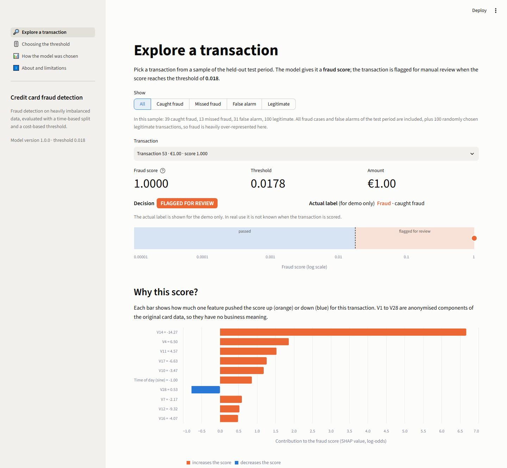

# Credit Card Fraud Detection on Imbalanced Data

[](https://github.com/kiko4902/credit-card-fraud-detection/actions/workflows/ci.yml)

**Live app: <https://fraud-detection-smote.streamlit.app/>**

## Problem and key result

About one card transaction in 540 in this dataset is fraud. A model that calls everything
legitimate is 99.8 % accurate and useless, so this project is mostly about evaluating a
fraud model honestly: a time-based split with no leakage, PR-AUC instead of accuracy, a
decision threshold chosen from costs, and a test set that was used exactly once.

**Result on the held-out test period** (the last 15 % of the data by time, 42,561
transactions, 52 of them fraud):

- The selected model, XGBoost trained on data oversampled with Safe-Level-SMOTE, reaches
  **PR-AUC 0.758** (95 % interval 0.640 to 0.862).
- At the cost-based threshold it catches **39 of 52 fraud cases with 31 false alarms**. It
  removes **56 % of the fraud cost** compared with no model (interval 23 % to 86 %),
  assuming a missed fraud costs its amount and every flagged transaction costs a €5 review.
- **XGBoost with class weights performed equally well on test** (PR-AUC 0.762, and €139
  cheaper). The selected model was kept because the selection rule was fixed before any
  result was seen, not because it won. This is consistent with the finding of my MSc
  thesis that oversampling mainly shifts the decision threshold and does not improve the
  ranking.
- The intervals are wide because there are only about 50 fraud cases per evaluation
  period. Every number here should be read with that in mind.

Full reports: [final evaluation](reports/final_evaluation.md),
[experiments](reports/experiments_summary.md), [project plan](docs/PLAN.md).

## Live app

<https://fraud-detection-smote.streamlit.app/>

Pick a transaction from the test period, see its fraud score, the decision and the
features that drove it; move the threshold and watch cost, recall and false alarms change.

[](https://fraud-detection-smote.streamlit.app/)

## Validation design and why it matters

Most public notebooks on this dataset report results that would not hold in use. The
usual causes are avoided here:

- **Time-based split.** The first 70 % of the period is for training, the next 15 % for
  model selection and the threshold, the last 15 % for the final test. A model is never
  evaluated on transactions older than the ones it learned from. Cross-validation inside
  the training period is time-ordered as well.
- **Resampling and scaling inside the pipeline.** Oversampling is fitted on training folds
  only. Oversampling before the split puts synthetic copies of test fraud into the training
  data and inflates every metric.
- **Duplicates removed before splitting**, so the same transaction cannot be on both sides.
- **Raw time is not a feature.** Only the time of day is used; the raw counter would let
  the model learn which part of the two days a row is from.
- **PR-AUC as the primary metric.** With 0.17 % fraud, accuracy and ROC-AUC look excellent
  for almost any model.
- **The test set was used once.** The evaluation protocol was written down first
  ([PLAN.md §15](docs/PLAN.md)), and the one access is logged in
  [`reports/test_set_access.log`](reports/test_set_access.log).

How much the split matters: the same model evaluated on a stratified random split gets
PR-AUC 0.821 and precision 0.92, against 0.758 and 0.56 on the time-based split.

## Results

108 configurations were compared in three stages: 9 classifiers with no resampling, class
weights and SMOTE; then the SMOTE family (SMOTE, SMOTE-Tomek, SMOTE-ENN, Safe-Level-SMOTE,
Polynom-Fit SMOTE) for the best 4; then a small hyperparameter search. The rule for
picking the winner (best mean cross-validated PR-AUC, ties within 0.005 go to the simpler
strategy) was fixed in advance.

Best strategy per classifier in the screening stage (PR-AUC; CV is the mean over 3
time-ordered folds, validation has 55 fraud cases):

| Classifier | No resampling (CV) | Class weights (CV) | SMOTE 0.1 (CV) | Validation, best strategy |
|---|---|---|---|---|
| XGBoost | 0.475 | 0.740 | **0.756** | 0.828 |
| LightGBM | 0.134 | 0.740 | **0.751** | 0.828 |
| Extra trees | **0.741** | 0.723 | 0.740 | 0.871 |
| Random forest | **0.741** | 0.739 | 0.732 | 0.861 |
| Logistic regression | 0.561 | 0.663 | **0.741** | 0.807 |
| MLP | **0.713** | n/a | 0.666 | 0.900 |
| k-NN | **0.618** | n/a | 0.490 | 0.800 |
| Decision tree | **0.464** | 0.381 | 0.181 | 0.378 |
| Gaussian NB | 0.063 | n/a | **0.066** | 0.050 |

Final test results, each model at the threshold chosen for it on validation:

| Model | PR-AUC [95 % CI] | Precision | Recall | Caught / false alarms / missed | Cost | Savings vs no model |
|---|---|---|---|---|---|---|
| **XGBoost, Safe-Level-SMOTE 0.5 (selected)** | 0.758 [0.640, 0.862] | 0.557 | 0.750 | 39 / 31 / 13 | €2,722 | €3,446 (56 %) |
| XGBoost, class weights | 0.762 [0.644, 0.865] | 0.905 | 0.731 | 38 / 4 / 14 | €2,583 | €3,586 (58 %) |
| XGBoost, no resampling | 0.539 [0.402, 0.699] | 0.714 | 0.673 | 35 / 14 / 17 | €2,705 | €3,464 (56 %) |
| MLP, no resampling | 0.767 [0.646, 0.870] | 0.972 | 0.673 | 35 / 1 / 17 | €2,846 | €3,323 (54 %) |

The reference rows were computed after the selection and did not influence it.

What the comparison shows:

- **The top of the ranking is a tie.** The best 14 configurations are within 0.016
  cross-validated PR-AUC of each other, while the folds of one configuration differ by
  about 0.07.
- **Doing something about the imbalance matters for the boosted models; which method
  matters little.** XGBoost goes from 0.475 to about 0.75 with class weights or any
  oversampling. Random forest and extra trees gain nothing.
- **Oversampling moves the threshold.** The oversampled model's cost-optimal threshold is
  0.018; with the default 0.5 its validation cost triples. For class weights, 0.5 is
  already close to optimal.
- **SMOTE-Tomek is identical to SMOTE on this data**: after SMOTE there are no Tomek links
  left to remove.
- **LightGBM with default settings is numerically unstable here**; the cause is diagnosed
  in the [experiment summary](reports/experiments_summary.md).

## PR curves and cost vs threshold


The threshold minimises cost on validation: a missed fraud costs its amount, every flagged
transaction costs one €5 review.

## Limitations

- **The threshold is unstable.** Over bootstrap resamples of validation the cost-optimal
  threshold ranges from 0.018 to 0.97, because the cost curve is flat around its minimum
  and 55 fraud cases cannot pin it down. It must be re-validated on fresh data before
  anyone relies on it.
- **Two days of data, about 50 fraud cases per evaluation period.** Validation and test
  cover only the afternoon and evening of the second day.
- **The output is a fraud score, not a probability.** The model is trained on oversampled
  data and there are too few cases to calibrate it.
- **Anonymised features.** V1 to V28 are principal components, so the SHAP explanations
  show which components drive a score, not a reason an analyst could act on.
- **The cost model is a simplification** (fixed review cost, reviews always recognise
  fraud).

The full list is in the [final evaluation](reports/final_evaluation.md#limitations).

## How to run

Requirements: [uv](https://docs.astral.sh/uv/) and GNU make. Python 3.12 is installed by
uv. On Windows, run the commands in Git Bash.

**Serve the committed model** (no dataset needed):

```bash
make install        # install dependencies exactly as pinned in uv.lock
make app            # Streamlit app on http://localhost:8501
make api            # FastAPI on http://127.0.0.1:8000, interactive docs at /docs
make docker-build   # API image
make docker-run     # API container on http://127.0.0.1:8000
docker compose up --build   # API and app together
```

The API has `POST /predict`, `POST /predict/batch` (up to 1,000 transactions),
`GET /health` and `GET /model-info`. A single prediction takes about 10 ms.

**Reproduce the results** (needs a Kaggle API token in `~/.kaggle/` or the
`KAGGLE_API_TOKEN` environment variable):

```bash
make data             # download the dataset into data/raw/ (not committed)
make notebook         # re-run the EDA notebook
make train-baseline   # logistic regression baseline
make experiments      # the three experiment stages and their report (resumable)
make lint
make test             # uses synthetic data, no dataset needed
```

`make evaluate` runs the final evaluation and loads the test split. It has been run once
for the reported results; running it again is logged in `reports/test_set_access.log`.

## Repository

```
src/fraud/     data, features, samplers, models, experiments, threshold, explain, serving
app/           api.py (FastAPI), streamlit_app.py, data/ (sample and validation scores)
models/        the final pipeline and its config
reports/       results.csv, the two reports, figures/
notebooks/     01_eda.ipynb
tests/         pytest on synthetic data
docs/PLAN.md   the project plan, including the rules fixed before the experiments
```

Safe-Level-SMOTE and Polynom-Fit SMOTE are implemented in `src/fraud/samplers.py` from the
original papers (Bunkhumpornpat et al. 2009; Gazzah and Amara 2008).

## Motivation: MSc thesis

The project extends my MSc thesis:

> Kristian Džoić, *Analiza algoritama zasnovanih na SMOTE za rukovanje problemom
> neuravnoteženosti klasa* (Analysis of SMOTE-based algorithms for handling class
> imbalance), MSc thesis, Faculty of Electrical Engineering, Computer Science and
> Information Technology Osijek (FERIT), 2026.

The thesis compared oversampling methods on 18 datasets with 8 classifiers and imbalance
ratios up to 28:1. This dataset is far more extreme, at about 540:1. Two thesis findings
were tested:

- **Oversampling barely changes PR-AUC on average and mainly shifts the decision
  boundary.** Supported here against class weights: the ranking is the same, and the cost
  difference at threshold 0.5 disappears once each model gets its own threshold. Not
  supported against no resampling for XGBoost, where oversampling improves the ranking
  itself.
- **Safe-Level-SMOTE and Polynom-Fit SMOTE beat plain SMOTE.** Only partly: Safe-Level-SMOTE
  is consistently better for XGBoost, but for the tree ensembles in general the
  differences between SMOTE variants are within noise.

Details are in the [experiment summary](reports/experiments_summary.md#comparison-with-the-thesis).

## Data and licence

[Credit Card Fraud Detection](https://www.kaggle.com/datasets/mlg-ulb/creditcardfraud)
(ULB Machine Learning Group), Open Database License (ODbL). The raw CSV is not part of
this repository.
