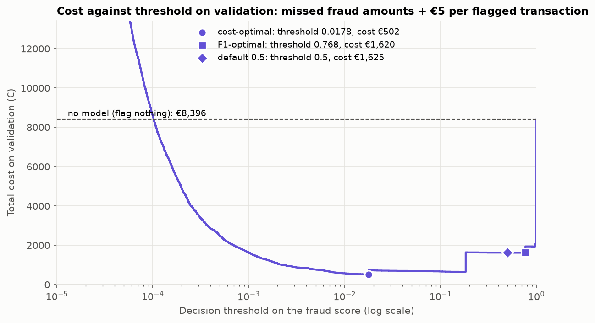
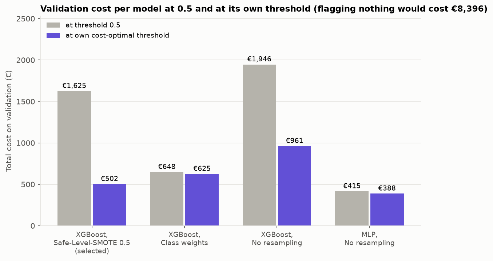
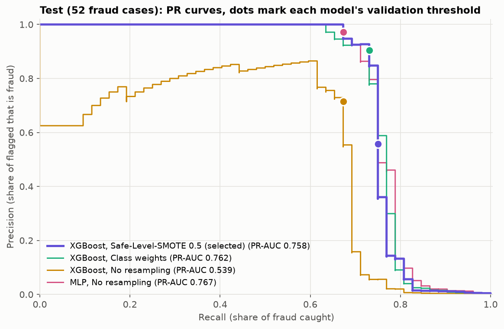
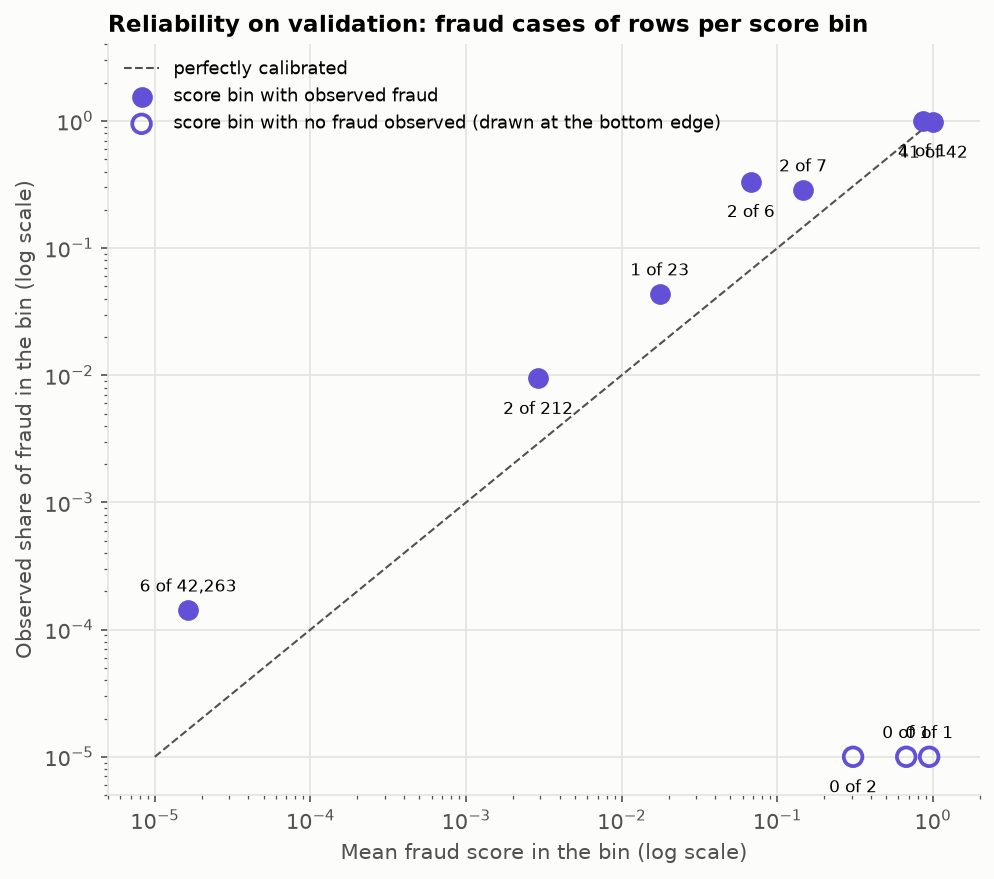
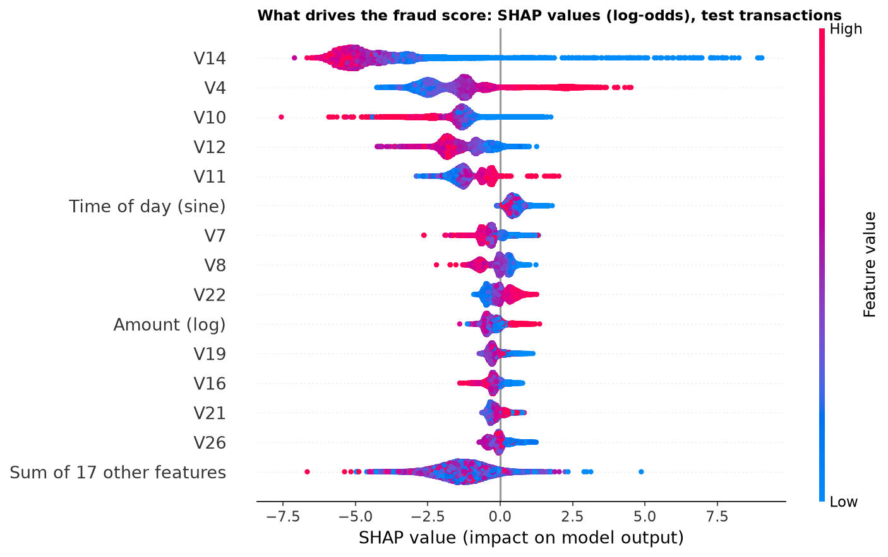
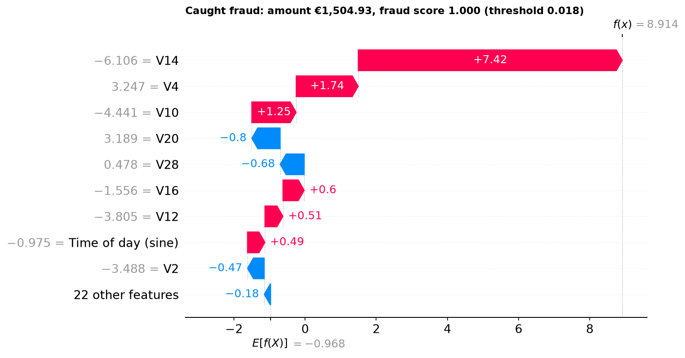
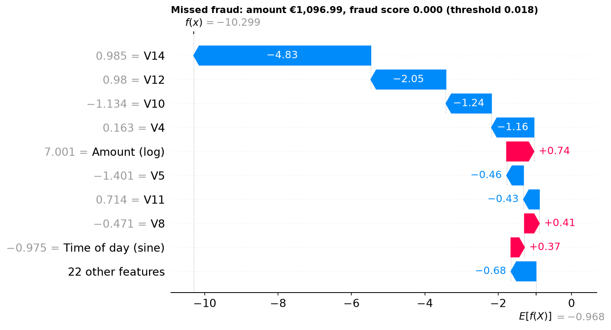
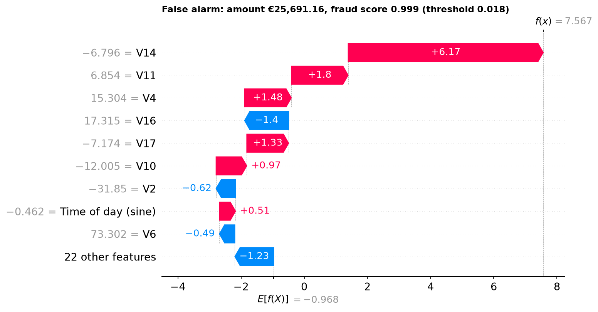

# Final evaluation (Phase 4)

## Conclusions

- **On the test split the model removes about half of the fraud cost, with a wide margin of
  error.** At the validation threshold (0.018) it catches 39 of 52 fraud cases with 31 false
  alarms and costs €2,722, against €6,169 for flagging nothing: savings of €3,446
  [€1,050, €7,272], or 56 % [23 %, 86 %] of the no-model cost. Test PR-AUC is 0.758
  [0.640, 0.862].
- **Validation was optimistic.** Validation PR-AUC was 0.851 and the in-sample savings at
  the chosen threshold were 94 %. Part of the drop is the threshold being fitted to 55
  fraud cases, part is that the test period is simply harder: all four models lose 0.07 to
  0.13 PR-AUC from validation to test. The remaining cost is dominated by a few large
  missed frauds; the largest one alone is €1,097 of the €2,722.
- **XGBoost with class weights performed equally well on test.** The selected model is
  kept because the selection rule was fixed in advance, not because it won: XGBoost with
  class weights has the same PR-AUC (0.762 against 0.758, difference -0.003
  [-0.020, +0.012]) and is €139 cheaper [€90, €198], because the selected model raises 27
  more false alarms to catch one more fraud. The MLP is level as well (PR-AUC 0.767). The
  four models are within €263 of each other in cost. These comparisons were made after
  selection and do not change it; they confirm the Phase 3 finding that the top
  configurations are tied. This is consistent with the thesis finding that oversampling
  mainly shifts the decision threshold and does not improve the ranking: against class
  weights, oversampling bought nothing on test.
- **Doing something about the imbalance matters for ranking, not much for cost.** XGBoost
  without resampling has a much lower test PR-AUC (0.539) but nearly the same cost
  (€2,705) once it has its own threshold: under this cost model a handful of large frauds
  decide the cost, and those are caught or missed by all models alike.
- **The threshold is the weakest part.** The cost-optimal threshold is 0.018, far from 0.5,
  and over bootstrap resamples of validation it ranges from 0.018 to 0.97: the cost curve
  is flat and 55 fraud cases cannot pin it down. In hindsight 0.005 would have been €429
  cheaper on test.
- **The output is a fraud score, not a probability,** and deduplication does not change
  any test result (the 183 duplicates in the test period contain no fraud).

## Thesis hypothesis: does oversampling mainly shift the decision boundary?

**Partly supported, depending on what oversampling is compared with.** Evidence from
validation (table "Thesis hypothesis test on validation"):

- **Against class weights: supported.** The ranking is the same (PR-AUC difference +0.015
  [-0.022, +0.055]). At threshold 0.5 the two models look very different in cost (the
  oversampled model is €977 more expensive), but once each gets its own threshold the gap
  is €122 the other way, with an interval that includes zero. The difference between
  oversampling and class weights is where the threshold has to be put, not how well the
  model ranks.
- **Against no resampling: not supported.** Here oversampling changes the ranking itself
  (PR-AUC +0.181 [+0.061, +0.289]), and the cost gap does not shrink when thresholds are
  optimised (-€321 at 0.5, -€459 at the optima; both intervals just include zero). For
  XGBoost at 540:1 the unweighted model is a worse ranker, so "only the boundary moves" is
  false for this pair.
- **Against the MLP without resampling: supported in the same sense as for class weights.**
  The gap of €1,210 at 0.5 shrinks to €115 at the optima.
- **The practical consequence** is the opposite of what one might expect from
  oversampling: the oversampled model is the one whose default threshold is wrong. Its
  optimum is 0.018 and using 0.5 triples its validation cost (€1,625 against €502), while
  for class weights and the MLP 0.5 is already close to optimal.
- **On test** (after selection) the picture is the same: equal ranking for the selected
  model, class weights and the MLP, and costs within €263 of each other at the validation
  thresholds.

Caveats: the selected model is tuned (400 trees, learning rate 0.1) and the references use
default parameters, so strategy and hyperparameters are not perfectly separated. None of
the cost differences on validation has an interval that excludes zero. This is one dataset
and one seed.

## Limitations

- **Two days of data.** The model has seen one full day and part of a second. Nothing here
  says how it behaves across weekdays, weekends, month ends or months later.
- **No night hours in validation or test.** Both cover only the afternoon and evening of
  day 2, while the fraud rate is highest at night. The threshold and all reported results
  are for those hours; the time-of-day features cannot be checked at night at all.
- **About 50 fraud cases per evaluation split** (55 in validation, 52 in test). Every
  interval is wide: test savings between 23 % and 86 %, recall between 0.63 and 0.87.
- **The threshold is unstable.** Over bootstrap resamples of validation the cost-optimal
  threshold ranges from 0.018 to 0.97. The cost curve is flat around its minimum, and with
  55 fraud cases a single large fraud moving above or below the threshold decides where
  the minimum is. On test, 0.005 would have been €429 cheaper than the chosen 0.018.
  Practical consequence: the threshold must be re-validated on fresh data before anyone
  relies on it, and again whenever the review cost or the mix of transactions changes.
- **PCA-anonymised features.** V1 to V28 have no business meaning, so the SHAP
  explanations show which components drive a score but not why in terms a fraud analyst
  could act on.
- **The cost model is a simplification.** The €5 review cost is an assumption; a review is
  assumed to always recognise fraud; a blocked legitimate customer costs nothing beyond
  the review; one threshold is used regardless of the amount, although a €1 fraud is
  cheaper to miss than to review.
- **The secondary random split is more optimistic** (PR-AUC 0.821 against 0.758, precision
  0.92 against 0.56), as expected when test transactions come from the same hours as the
  training data. Its intervals overlap with the time-based ones, so the size of the
  optimism is uncertain.
- **Scores are not calibrated probabilities.** The model is trained on data oversampled to
  a 1:2 class ratio. On validation the scores between 0.001 and 0.25 are lower than the
  observed fraud rates in those bins, and the bins in between hold 1 to 23 rows, too few
  to fit or check a calibration. The API and the app should therefore call the output a
  fraud score and compare it with the threshold, not present it as a probability of fraud.
- **The test split has now been used.** Any further change to the model or the threshold
  based on these results would need new data to be evaluated honestly.

<!-- generated:start -->
## Setup

- Model: **XGBoost, Safe-Level-SMOTE 0.5 (selected)**, `xgboost__safe_level_smote__0.5__a11f01a5`, model version 1.0.0, fitted on the training split only. It is **not** refitted on train + validation: the threshold below is chosen on validation scores of exactly this model, and a refitted model would have a different score distribution.

- Rows: train 198,607 (366 fraud), validation 42,558 (55 fraud), test 42,561 (52 fraud). Exact duplicates removed before splitting.

- Cost model: a missed fraud costs its amount; every flagged transaction costs a €5 review, fraud or not.

- Intervals: 95 %, stratified bootstrap with 1000 resamples. Evaluated at commit `a94dc49`.

- Validation scores of every model reproduce the Phase 3 scores.

## Threshold (chosen on validation only)

The cost-minimising threshold of the selected model is **0.01783**. Over bootstrap resamples of validation the optimal threshold ranges from 0.01783 to 0.968 (median 0.01783), so the cost curve is flat around its minimum and the exact value is not well determined by this few fraud cases.

| Model | Cost-optimal threshold | Flagged | Fraud caught | Cost at optimum | Cost at 0.5 | F1-optimal threshold | Best F1 | Cost at F1 optimum |
|---|---|---|---|---|---|---|---|---|
| XGBoost, Safe-Level-SMOTE 0.5 (selected) | 0.01783 | 68 | 47 of 55 | €502 | €1,625 | 0.7681 | 0.848 | €1,620 |
| XGBoost, Class weights | 0.8481 | 44 | 42 of 55 | €625 | €648 | 0.8067 | 0.860 | €629 |
| XGBoost, No resampling | 0.3001 | 46 | 39 of 55 | €961 | €1,946 | 0.565 | 0.779 | €1,936 |
| MLP, No resampling | 0.7992 | 44 | 42 of 55 | €388 | €415 | 0.566 | 0.895 | €405 |

Costs in this table are in-sample: the threshold was chosen on the same validation rows.

## Thesis hypothesis test on validation

Selected model minus each reference, on the same validation rows (paired bootstrap). For cost, a negative difference means the selected model is cheaper. In the last column every model gets its own cost-optimal threshold, chosen again inside each resample. `*` marks a 95 % interval that excludes zero.

| Selected minus | PR-AUC | Cost, both at 0.5 | Cost, each at its own optimum |
|---|---|---|---|
| XGBoost, Class weights | +0.015 [-0.022, +0.055] | +€977 [-€33, +€2,979] | -€122 [-€607, +€39] |
| XGBoost, No resampling | +0.181 [+0.061, +0.289] * | -€321 [-€796, +€7] | -€459 [-€1,129, +€10] |
| MLP, No resampling | -0.049 [-0.097, -0.006] * | +€1,210 [-€28, +€3,674] | +€115 [-€2, +€159] |

## Final results on the test split

Selected model at the validation threshold 0.01783. The test split was loaded once, for this evaluation.

| Metric | Value [95 % CI] |
|---|---|
| PR-AUC | 0.758 [0.640, 0.862] |
| ROC-AUC | 0.976 [0.959, 0.990] |
| Precision | 0.557 [0.463, 0.662] |
| Recall | 0.750 [0.635, 0.865] |
| F1 | 0.639 [0.548, 0.727] |
| Total cost | €2,722 [€623, €5,381] |
| Cost with no model (flag nothing) | €6,169 [€2,711, €10,391] |
| Cost of flagging everything | €212,805 |
| Savings against no model | €3,446 [€1,050, €7,272] |
| Savings as a share of the no-model cost | 55.9% [22.6%, 86.0%] |
| Savings against flagging everything | €210,083 [€207,424, €212,182] |

|  | Passed | Flagged |
|---|---|---|
| Actually legitimate | 42,478 | 31 (false alarms) |
| Actually fraud | 13 (missed) | 39 (caught) |

In hindsight the cheapest threshold on these rows would have been 0.004833 (cost €2,293); the validation threshold costs €2,722. This is a diagnostic only and was not used.

### Reference models (reported after selection, not used for it)

Each model at its own validation threshold.

| Model | Threshold (from validation) | PR-AUC | ROC-AUC | Precision | Recall | F1 | TP / FP / FN | Cost | Savings against no model |
|---|---|---|---|---|---|---|---|---|---|
| XGBoost, Safe-Level-SMOTE 0.5 (selected) | 0.01783 | 0.758 [0.640, 0.862] | 0.976 | 0.557 | 0.75 [0.63, 0.87] | 0.639 | 39 / 31 / 13 | €2,722 | €3,446 [€1,050, €7,272] |
| XGBoost, Class weights | 0.8481 | 0.762 [0.644, 0.865] | 0.975 | 0.905 | 0.73 [0.60, 0.85] | 0.809 | 38 / 4 / 14 | €2,583 | €3,586 [€1,224, €7,412] |
| XGBoost, No resampling | 0.3001 | 0.539 [0.402, 0.699] | 0.904 | 0.714 | 0.67 [0.54, 0.79] | 0.693 | 35 / 14 / 17 | €2,705 | €3,464 [€1,083, €7,263] |
| MLP, No resampling | 0.7992 | 0.767 [0.646, 0.870] | 0.969 | 0.972 | 0.67 [0.54, 0.79] | 0.795 | 35 / 1 / 17 | €2,846 | €3,323 [€954, €7,039] |

Selected minus reference on the test split, each at its validation threshold. `*` marks a 95 % interval that excludes zero.

| Selected minus | PR-AUC | Cost |
|---|---|---|
| XGBoost, Class weights | -0.003 [-0.020, +0.012] | +€139 [+€90, +€198] * |
| XGBoost, No resampling | +0.219 [+0.093, +0.330] * | +€18 [-€109, +€124] |
| MLP, No resampling | -0.009 [-0.054, +0.028] | -€123 [-€653, +€183] |

### With and without deduplication

The same model and threshold on the test period with its 183 exact duplicate rows (0 of them fraud) put back.

| Rows | PR-AUC | Precision | Recall | TP / FP / FN | Savings share of no-model cost |
|---|---|---|---|---|---|
| Deduplicated (primary) | 0.758 [0.640, 0.862] | 0.557 | 0.75 [0.63, 0.87] | 39 / 31 / 13 | 55.9% [22.6%, 86.0%] |
| With exact duplicates | 0.758 [0.641, 0.867] | 0.557 | 0.75 [0.62, 0.87] | 39 / 31 / 13 | 55.9% [22.9%, 86.0%] |

### Secondary analysis: stratified random split

**Not the primary result.** The same configuration refitted on a stratified random 70/15/15 split of the deduplicated data (71 fraud cases in its test part), with its own validation threshold (0.3022). A random split tests on transactions from the same hours the model was trained on, so it does not estimate performance on future data.

| Split | PR-AUC | Precision | Recall | TP / FP / FN | Savings share of no-model cost |
|---|---|---|---|---|---|
| Time-based (primary), test | 0.758 [0.640, 0.862] | 0.557 | 0.75 [0.63, 0.87] | 39 / 31 / 13 | 55.9% [22.6%, 86.0%] |
| Stratified random (secondary), test part | 0.821 [0.739, 0.905] | 0.918 | 0.79 [0.69, 0.89] | 56 / 5 / 15 | 61.6% [39.2%, 85.2%] |

## Score or probability?

Reliability of the selected model on validation, in fixed score bins. Brier score 0.00034 (always predicting the base rate: 0.00129). The scores sum to 48.2 expected fraud cases; validation has 55.

| Score bin | Rows | Fraud | Mean score | Observed fraud rate |
|---|---|---|---|---|
| 0 to 0.001 | 42,263 | 6 | 0.0000 | 0.0001 |
| 0.001 to 0.01 | 212 | 2 | 0.0029 | 0.0094 |
| 0.01 to 0.05 | 23 | 1 | 0.0176 | 0.0435 |
| 0.05 to 0.1 | 6 | 2 | 0.0676 | 0.3333 |
| 0.1 to 0.25 | 7 | 2 | 0.1465 | 0.2857 |
| 0.25 to 0.5 | 2 | 0 | 0.3068 | 0.0000 |
| 0.5 to 0.75 | 1 | 0 | 0.6737 | 0.0000 |
| 0.75 to 0.9 | 1 | 1 | 0.8624 | 1.0000 |
| 0.9 to 0.99 | 1 | 0 | 0.9454 | 0.0000 |
| 0.99 to 1 | 42 | 41 | 0.9993 | 0.9762 |

## Explainability (SHAP)

TreeExplainer on the XGBoost step of the pipeline. SHAP values are in log-odds of the fraud score; base value -0.97. Base value plus the SHAP values of a row reproduces the model output to within 1.9e-05.

| Feature | Mean absolute SHAP value (test rows) |
|---|---|
| V14 | 4.558 |
| V4 | 1.787 |
| V10 | 1.428 |
| V12 | 1.263 |
| V11 | 1.050 |
| Time of day (sine) | 0.484 |
| V7 | 0.391 |
| V8 | 0.345 |
| V22 | 0.323 |
| Amount (log) | 0.320 |

**Caught fraud** (amount €1,504.93, score 1.000): strongest V14 +7.42, V4 +1.74, V10 +1.25, V20 -0.80, V28 -0.68.

**Missed fraud** (amount €1,096.99, score 0.000): strongest V14 -4.83, V12 -2.05, V10 -1.24, V4 -1.16, Amount (log) +0.74.

**False alarm** (amount €25,691.16, score 0.999): strongest V14 +6.17, V11 +1.80, V4 +1.48, V16 -1.40, V17 +1.33.

A sample of 183 test transactions with score, decision and SHAP values is saved to `app/data/explained_sample.csv` for the Streamlit app (100 legitimate, 39 caught fraud, 31 false alarm, 13 missed fraud). It holds no row identifiers; `Time` is reduced to the second of the day.
<!-- generated:end -->
